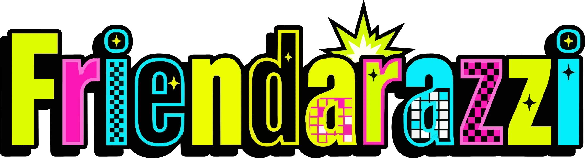

# Friendarazzi

> **Turn hangouts, trips, and parties into a candid photo-hunting Bingo game.**

Someone in your group is definitely going to order questionable late-night food, fall asleep in a weird spot, or strike the exact same pose twice. **Friendarazzi** turns those moments into secret Bingo boards where friends race to catch each other on camera.

---

## How a Match Plays Out

### 1. Create a Lobby & Invite Friends
Start a match, pick your board size (**3×3**, **4×4**, or **5×5**), choose your stealth level, and drop the short invite link into the group chat.

### 2. Draft Prompts Together (or Roll a Starter Deck)
Every player submits fun habits or challenges distributed evenly across the rest of the group. In a rush? Tap one of the **4 curated Quick-Start decks** and tweak or reroll prompts in seconds:

- **Night Out** — bars, clubs, and late-night detours
- **Urlaub & Festival** — roadtrips, airports, tents, and sunburns
- **WG & Zuhause** — kitchen chaos, roommate habits, and couch moments
- **Büro & Uni** — coffee runs, deadlines, and lecture-hall classics

### 3. Balanced Secret Bingo Cards
Once everyone locks in, Friendarazzi builds a unique Bingo board for each player. Smart balancing ensures you **never** receive a prompt you wrote yourself—or a tile where *you* are the target.

### 4. Hunt in Your Favorite Stealth Mode
Snap or upload photo proof right from your mobile browser. Pick how much chaos the group sees mid-game:

| Mode | What Friends See Mid-Game | Best For |
| --- | --- | --- |
| **Undercover** *(Default)* | Captures stay hidden until someone calls Bingo | Maximum stealth & a big end-of-game slideshow reveal |
| **Blurred Teaser** | Heavily pixelated thumbnail + timestamp only | Building suspense without spoiling the target |
| **Live Feed** | Instant photo stream & live tile notifications | Trash-talking & watching rivals get close to Bingo |

### 5. Hit Bingo, Earn Gold & Relive the Night
Complete any **row, column, or diagonal** to end the round immediately:

- **Gold Medals & Rank Flair:** Every win awards a permanent Gold Medal on your profile, unlocking titles from *Neuling* and *Schnappschuss-Jäger* all the way up to *Paparazzo*, *Paparazzi King*, and *Grandmaster*.
- **Post-Game Superlatives:** Automatic awards for **Most Wanted** (most caught), **Ghost** (least caught), **Quickest Draw** (fastest capture), and **Sniper** (most captures in a 1-hour burst).
- **1:1 Proportional Timeline:** Scrub across a real-time scaled timeline from start to finish—quiet hours stay spaced out, while chaotic bursts cluster together.
- **Native-Style Photo Memories:** Browse every unlocked board in the game recap, or visit any profile for game-grouped **Caught** (*of you*) and **Captured** (*by you*) photo galleries.

---

## Self-Hosting, Contributing & License

- **Self-Deployment:** You can run your own instance via Docker Compose—see [`docs/deployment.md`](docs/deployment.md).
- **Contributing & Local Setup:** Want to hack on Friendarazzi locally or open a PR? Read [`.github/CONTRIBUTING.md`](.github/CONTRIBUTING.md).
- **License:** [GNU Affero General Public License v3.0](LICENSE).
